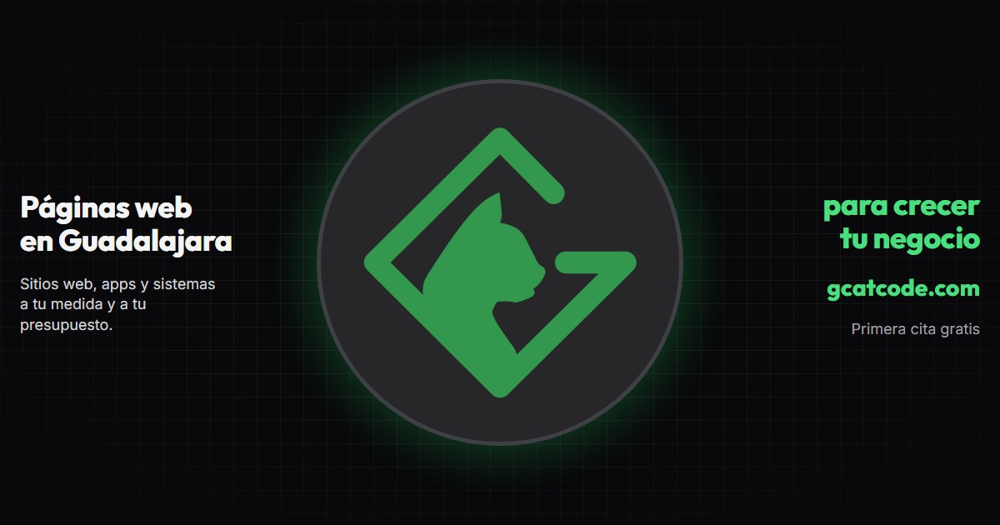

# GCatcode - Páginas web en Guadalajara y CV de Jorge Osvaldo Perez Mendoza

[Español](./README_ES.md) | [English](./README.md)



Código fuente de [gcatcode.com](https://gcatcode.com): el sitio de **GCatcode**, páginas web y apps que ayudan a crecer a los negocios de Guadalajara y Zapopan, y el CV y portafolio de su dueño, Jorge Osvaldo Perez Mendoza, **Ingeniero en Desarrollo de Software** (Backend, Full Stack Web).

## 📄 Descarga mi Currículum

Puedes encontrar un desglose detallado de mi experiencia laboral, mis habilidades y formación académica en el siguiente documento:

👉 **[Descargar CV en PDF (Inglés)](./CV%20Jorge%20Osvaldo%20Perez%20Mendoza%20EN.pdf)**

---

## 🌐 Sobre este Proyecto

El sitio está diseñado para ser rápido, accesible y optimizado para motores de búsqueda (SEO). Está construido con una arquitectura moderna de generación de sitios estáticos para garantizar el mejor tiempo de respuesta posible.

### 🗺️ Secciones del sitio

| Sección | Español (predeterminado) | Inglés |
| --- | --- | --- |
| Landing de GCatcode | `/` | `/en/` |
| CV | `/cv/` | `/en/cv/` |
| Proyectos | `/projects/` | `/en/projects/` |
| Términos y condiciones | `/terminos/` | `/en/terminos/` |
| Aviso de privacidad | `/privacidad/` | `/en/privacidad/` |

### ✨ Características

- **Internacionalización (i18n):** Soporte bilingüe (Inglés y Español) con una sola plantilla por ruta y diccionarios de traducción por idioma (agregar un idioma consiste en añadir un diccionario y registrar el locale), además de enlaces hreflang alternos en las páginas y el sitemap. La compilación falla si los diccionarios dejan de coincidir.
- **Optimización de Buscadores (SEO):** Implementación integral con Open Graph, Sitemap dinámico y Twitter Cards. Las páginas del negocio se comparten con una imagen de 1200x630 por idioma cuyo cuadrado central contiene el logo, para que se vea bien en vistas previas cuadradas como la de WhatsApp.
- **Diseño Moderno:** Interfaz responsiva y amigable (Glassmorphism, gradientes fluidos y transiciones suaves).

### 🛠️ Tecnologías Principales

- **[Astro](https://astro.build/)**: Framework web optimizado para velocidad y entrega de contenido.
- **[Tailwind CSS 4](https://tailwindcss.com/)**: Estilos con clases de utilidad mediante el plugin `@tailwindcss/vite`. Los tokens de diseño (colores y tipografías) viven en `src/styles/global.css`, y solo las clases en uso terminan en el CSS final.
- **[@astrojs/sitemap](https://docs.astro.build/en/guides/integrations-guide/sitemap/)**: Genera el sitemap en tiempo de compilación.
- **[Firebase Hosting](https://firebase.google.com/docs/hosting) + GitHub Actions**: Cada pull request recibe un despliegue de vista previa, y cada merge a `main` despliega a producción.

---

## 🚀 Instalación y Ejecución Local

Si deseas correr este proyecto de manera local, necesitas Node.js `>= 22.12.0`. Sigue estas instrucciones:

1. Clona el repositorio:

   ```bash
   git clone https://github.com/Furiduri/Gcatcode.git
   cd Gcatcode
   ```

2. Instala las dependencias:

   ```bash
   npm install
   ```

3. Ejecuta el servidor de desarrollo local:
   ```bash
   npm run dev
   ```

El sitio estará disponible por defecto en `http://localhost:4321/`, con las rutas de la tabla de secciones del sitio.

## 🤝 Flujo de trabajo

El trabajo sigue [`AGENTS.md`](./AGENTS.md): un issue por cambio, una rama por issue, Conventional Commits y un pull request que el maintainer revisa archivo por archivo antes de hacer merge.

## 📬 Contacto

Si deseas platicar sobre tecnología, oportunidades laborales, o mi afición por los Juegos de Mesa, ¡no dudes en contactarme!

- **Email:** contacto@gcatcode.com
- **Sitio Web en Vivo:** [gcatcode.com](https://gcatcode.com) (CV en [gcatcode.com/cv](https://gcatcode.com/cv/))
